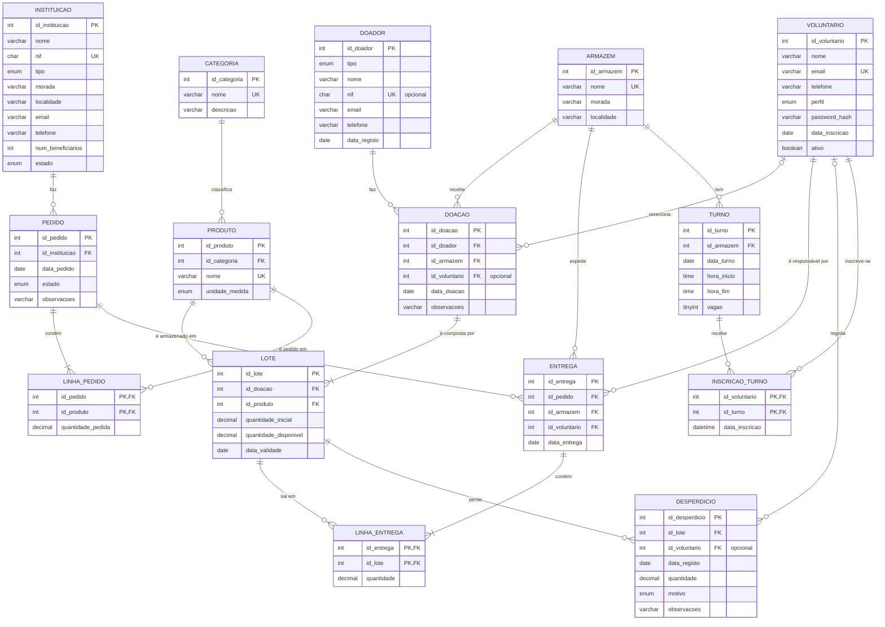

# ERD — Despensa Solidária

Notação: pé-de-galinha (engenharia da informação). `||` = exatamente um, `o|` = zero ou um, `|{` = um ou mais, `o{` = zero ou mais.
O diagrama corresponde exatamente a `data/schema.sql` (15 tabelas). Para uma imagem para o relatório, pode também ser gerado no MySQL Workbench em *Database → Reverse Engineer*.

## Relacionamentos e decisões de modelação

| Relacionamento | Cardinalidade | Notas |
|---|---|---|
| Categoria — Produto | 1:N, produto obrigatório numa categoria | |
| Doador — Doação | 1:N | Um doador pode estar registado sem doações (ex.: Pedro Almeida). |
| Doação — Lote | 1:N, **a doação tem pelo menos um lote** | O lote é a unidade de stock: um produto, uma quantidade e uma validade. |
| Armazém — Doação | 1:N | O armazém de um lote é o da sua doação (não é repetido no lote — 3FN). |
| Pedido — Produto | **N:M** via `LINHA_PEDIDO` | Os pedidos são feitos por produto, não por lote. |
| Entrega — Lote | **N:M** via `LINHA_ENTREGA` | Uma entrega retira de vários lotes; um lote pode sair em várias entregas. |
| Pedido — Entrega | 1:N | Um pedido pode ser satisfeito em várias entregas (estado `parcial`). |
| Voluntário — Turno | **N:M** via `INSCRICAO_TURNO` | Limitada por BR04 (3/semana) e BR06 (vagas). |
| Voluntário — Doação / Desperdício | 0..1:N (participação opcional) | Doações ao balcão e abates automáticos não têm voluntário. |

**Atributo derivado não guardado:** o stock de um produto não é uma coluna. É calculado como a soma de `LOTE.quantidade_disponivel` (view `vw_stock_disponivel`, função `fn_stock_disponivel`). Assim não podem existir dois valores de stock contraditórios.

**Atributo derivado guardado (exceção justificada):** `LOTE.quantidade_disponivel` podia ser calculado como `quantidade_inicial − Σ entregas − Σ desperdício`. É guardado porque a seleção FEFO e os alertas o consultam constantemente, e é mantido **apenas** por triggers (`trg_linha_entrega_ai`, `trg_desperdicio_ai`), com `CHECK` que impede valores negativos.
